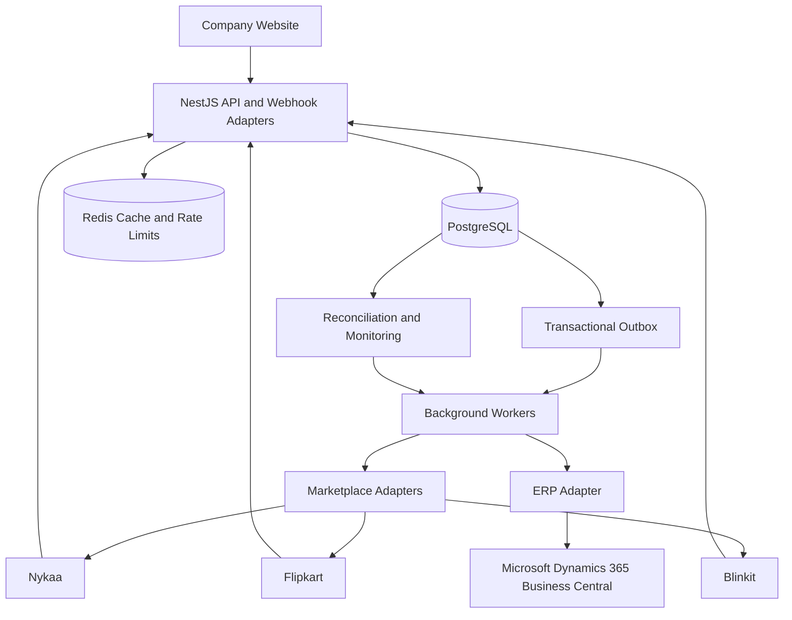

# Architecture Diagram

## Diagram Notes

- PostgreSQL is the source of truth for inventory, orders, reservations, and durable outbound jobs.
- Redis is used for caching and rate limiting, not as the authoritative inventory store.
- Background workers isolate external API delays from order transactions.
- Marketplace and ERP adapters handle channel-specific request formats, rate limits, retries, and reconciliation.
